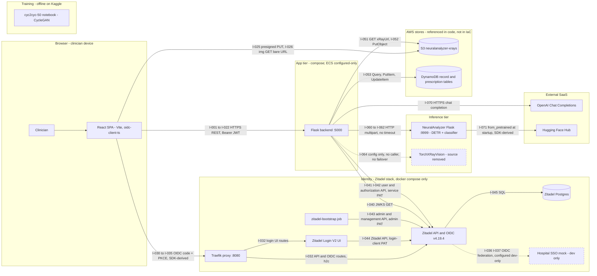
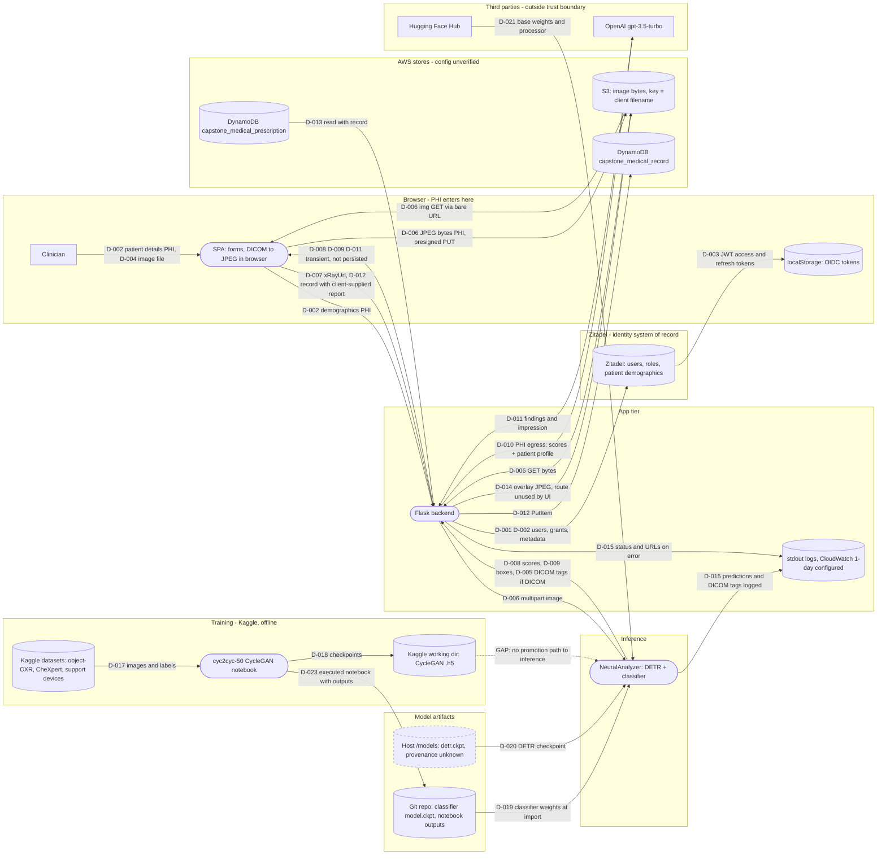

# LungVisionAI — Architecture Report (current-as-implemented)

## 1. Report metadata and scope

| Item | Value |
| --- | --- |
| Generated (UTC) | 2026-10-10T00:19Z |
| Method | Static, read-only inspection of source, configuration, IaC, CI/CD, tests and committed docs, plus non-mutating `git` queries. No services, containers, notebooks or builds were run. No cloud or production access. |
| Repository root | `LungVisionAI/` (single repository; git remote `origin` points at a GitHub repo). No sibling repositories were available in the workspace. |
| Branch / commit | `expo` @ `d9eb7c2` ("coder init commit", 2026-10-08) |
| Baseline audited | **The working tree as found, including uncommitted changes.** 48 tracked files differ from `HEAD` (+967 / −1215 lines) and 12 untracked source files exist. Snapshot fingerprint: `sha256(git diff HEAD --binary)` prefix `98669bc7c8473eab`. The owner confirmed no further changes were in flight. |
| Important baseline caveat | The uncommitted changes are **not** only dependency bumps. They contain the whole Cognito→Zitadel migration (`src/backend/runtime/data/zitadel.py`, `src/backend/scopes.py`, `src/backend/scripts/zitadel_bootstrap.py`, `src/zitadel/`, frontend `services/auth.js`, `pages/AuthCallbackPage.jsx`), browser DICOM conversion (`src/frontend/src/services/dicom.js`), the deletion of `src/backend/runtime/data/aws_cognito.py`, and the deletion of all of `docs/` except this folder. **`HEAD` still wires up `CognitoIdentityProvider`** (`git show HEAD:src/backend/runtime/__init__.py`). Anyone who checks out a commit gets a different auth architecture from the one described here. |
| Included | `src/backend`, `src/frontend` (source and config), `src/ai_services/neuralanalyzer`, `src/zitadel`, `src/docker-compose.yml`, `src/infrastructure` (Terraform), `.github/workflows`, `src/notebooks/cyc2cyc-50.ipynb` (**cell sources and output-type counts only**), committed design docs at `HEAD` under `docs/` (grep for design claims only), git history for removed components. |
| Deliberately not read | `src/.env` and `src/.env.prod` (tracked in git!) and `src/backend/.env` (local, ignored). Model weights (`src/ai_services/neuralanalyzer/models/classification/model.ckpt`). Notebook output payloads (15 embedded PNG images and text outputs). Image files (`src/frontend/public/sample.jpg`, other `public/*`, and X-ray JPEGs that still exist in git history). `node_modules`, lockfiles (not analysed in depth), `.claude/settings.local.json`. |
| Mermaid validation | `mmdc` is not installed; **render not validated**. The syntax was kept to the GitHub-compatible subset. |
| Confidence limits | No live AWS, Zitadel, OpenAI or Kaggle state was observed. Whether the S3 bucket and DynamoDB tables exist, and how they are configured, is unknown. Runtime behaviour of third-party SDKs (oidc-client-ts, PyJWT, boto3, transformers) is inferred from their documented defaults and labelled `SDK-derived`. |

Status labels used throughout: `[verified-in-code]` = executable caller/handler in this repo; `[configured-only]` = present in compose/IaC/CI/config, but the runtime path is not proven; `[planned]` = docs, TODOs or mocks only; `[unknown]` = not determinable from this repo; `[SDK-derived]` = an endpoint the library computes at runtime (for example from OIDC discovery), not a literal in code.

## 2. Executive summary

**Demonstrably built (working tree):**

- A **React 19 + Vite SPA** (`src/frontend`) that signs users in with **Zitadel via OIDC authorization code + PKCE in the browser** (`oidc-client-ts`). It calls a **Flask backend** (`src/backend/app.py`, 20 REST endpoints across 7 blueprints) with Bearer JWT access tokens.
- The backend **verifies Zitadel JWTs locally against JWKS**, with issuer, audience, expiry and required-claim checks (`src/backend/runtime/data/zitadel.py:79-90`). It authorizes routes by Zitadel project roles used as scopes (`src/backend/scopes.py`, `src/backend/decorators/login_required.py`).
- **Zitadel is the system of record for clinicians and patients.** Patient demographics and the doctor↔patient link live in Zitadel users and user metadata (`zitadel.py:115-186`). A dev-only Docker Compose stack runs Zitadel, its Login V2 UI, Postgres, a Traefik proxy, an idempotent bootstrap job and a **mock hospital SSO IdP** (`src/docker-compose.yml:66-218`).
- **X-ray images**: the browser converts DICOM to JPEG (`src/frontend/src/services/dicom.js`) and uploads bytes **directly to S3 with a presigned PUT** (`api.js:180-202`). Medical records and prescriptions go to **two DynamoDB tables** (`src/backend/runtime/__init__.py:23-24`). Neither the bucket nor the tables are defined in IaC.
- **Inference**: the backend sends the image to a single **NeuralAnalyzer Flask service**: a fine-tuned DETR detects 12 anatomical regions, and a transformer classifier scores 9 findings per region (`src/ai_services/neuralanalyzer`). The predictions are then sent to **OpenAI `gpt-3.5-turbo`** to write findings and an impression (`report_generation_service.py:17-60`).

**Biggest risky or uncertain boundaries:**

1. **Cross-patient access (object-level authorization).** Record, prescription and S3 routes check only the scope, not doctor↔patient ownership. Doctor sign-up is public and unverified, and SSO users get the doctor role on first login by default. A route test even asserts that a doctor can read another patient's record (`src/backend/test/test_zitadel.py:298`). → C-01
2. **PHI egress to OpenAI.** Every analysis sends the patient's full profile (name, email, phone, birthdate, gender, doctor link) plus the predictions to an external LLM (`report_generation_service.py:33-55`). → C-02
3. **Image identity and integrity.** The S3 key is the **client-supplied filename** in one flat namespace. Uploads overwrite objects with the same name, and records store only a bare URL. One patient's X-ray can silently replace another's behind an existing record. → C-03
4. **No fallback model and no persisted, versioned inference results.** TorchXRayVision was removed in `053d0ac` (2025-03-27), but config, IaC, CD and docs still refer to it. Predictions are persisted only if the browser posts them back, with no model version. → C-04, C-05
5. **Deployment drift.** Terraform and CD still target Cognito and the removed TorchXRayVision service. They have no Zitadel, no NeuralAnalyzer service, and no S3/DynamoDB resources, so the current backend would fail its config check at startup in that environment (`config.py:53-55` vs `main.tf:334-345`). Training lineage for the deployed weights is absent: the only notebook trains an unrelated CycleGAN. → C-06, C-11

## 3. System component inventory

| ID | Component | Responsibility | Entrypoint / runtime | Environment & deployment status | Exposure | Persistent state | Evidence |
| --- | --- | --- | --- | --- | --- | --- | --- |
| S-01 | React SPA | Login (OIDC), patient list and create, record create/view, upload, analysis UI | `src/frontend/index.html` → `src/frontend/src/index.jsx` → `App.jsx`; React 19, Vite 8, axios, oidc-client-ts, dicom-parser | Dev: Vite dev server :3000 in compose (`docker-compose.yml:2-18`) `[verified-in-code]`. Prod: nginx static image (`src/frontend/Dockerfile`, `nginx.conf`) on ECS `[configured-only]` | Public | Browser `localStorage` (OIDC user and tokens) | `src/frontend/package.json`, `src/frontend/src/services/auth.js:9-30` |
| S-02 | Flask backend API | AuthZ, user/patient management via Zitadel, records/prescriptions (DynamoDB), S3 presigning, inference and report orchestration | `src/backend/app.py:21-71`; Flask 3.1 dev server `app.run` on :5000 | Compose `[verified-in-code]`; ECS Fargate `[configured-only]` (stale env) | Public (compose host port; ALB in Terraform) | None local; uses S-10, S-11, S-03 | `app.py`, `runtime/__init__.py:10-28` |
| S-03 | Zitadel API / OIDC provider | Identity SoR, OIDC issuer, JWKS, user/metadata/authorization APIs | `ghcr.io/zitadel/zitadel:v4.19.4` `start-from-init` | **Compose dev only** (`docker-compose.yml:85-135`). No production definition anywhere in repo | Via S-05 on :8080 | S-06 | compose, `src/zitadel/README.md` |
| S-04 | Zitadel Login V2 UI | Hosted login pages (password + SSO buttons) | `ghcr.io/zitadel/zitadel-login:v4.19.4` | Compose dev only (`:137-158`) | Via S-05 | Session cookie (secret from env/default) | compose |
| S-05 | Traefik proxy | Single public Zitadel origin: `/` and `/ui/v2/login` → login UI, everything else → API (h2c) | `traefik:v3.7.7`, `src/zitadel/traefik.yml:4-33` | Compose dev only (`:160-176`) | Host :8080 | None | traefik.yml |
| S-06 | Zitadel Postgres | Zitadel event store, users, metadata, grants, sessions | `postgres:17.10-alpine` | Compose dev only (`:69-83`), named volume `zitadel-db-data` | Internal (`zitadel_network`) | **Authoritative identity and patient-demographics data** | compose |
| S-07 | zitadel-bootstrap | Idempotent provisioning: project, roles, OIDC app, backend service user and PAT, login policy, SSO IdP. Writes `zitadel.json` | `src/backend/scripts/zitadel_bootstrap.py:349-379` (backend image) | Compose one-shot (`:180-203`) | None | Writes `lungvision-auth` volume (service-user token, IDs) | bootstrap script |
| S-08 | Hospital SSO mock | Stand-in for hospital IdP (accepts **any** username) | `ghcr.io/navikt/mock-oauth2-server:6.0.2`, `src/zitadel/sso-mock.json` | **Dev only** (`docker-compose.yml:205-218`); a real IdP is `[unknown]` | Host :5556 | None | compose, sso-mock.json |
| S-09 | NeuralAnalyzer inference service | DICOM/image decode, DETR region detection, per-region disease classification, box overlay | `src/ai_services/neuralanalyzer/neural_app.py:11-176`; Flask dev server :9999; PyTorch 2.14, transformers 5.19, Lightning | Compose `[verified-in-code]`. **No ECS task/service in Terraform and no CD job** → prod hosting `[unknown]` | **Host port 9999 published, no auth** (`docker-compose.yml:48-49`) | Model files only (see D-019, D-020) | neural_app.py, detr_api.py, classification_api.py |
| S-10 | AWS DynamoDB | Medical records (`capstone_medical_record`, GSI `userId-index`); prescriptions (`capstone_medical_prescription`, GSI `recordId-index`), region `us-west-2` | boto3 resource, `src/backend/runtime/data/aws_dynamodb/*` | Referenced in code `[verified-in-code]`. **Tables not defined in IaC**; existence, encryption, PITR `[unknown]` | AWS API | Records, reports, predictions (client-supplied), prescriptions | `runtime/__init__.py:23-24`, `base_service.py` |
| S-11 | AWS S3 bucket `neuralanalyzer-xrays` | X-ray image bytes; segmentation overlays | boto3 client, `src/backend/runtime/data/aws_s3.py` | Referenced in code. **Bucket not in IaC**; region (client default `us-east-2`), policy, public access, versioning `[unknown]` | Presigned URLs; bare object URLs used in `` | Image bytes | `aws_s3.py:5-71`, `runtime/__init__.py:26` |
| S-12 | OpenAI Chat Completions | LLM report (findings + impression) | `openai==3.28.0` SDK, model `gpt-3.5-turbo` | External SaaS `[verified-in-code]` (caller) | Internet egress | Vendor-side retention `[unknown]` | `report_generation_service.py:9-60` |
| S-13 | Hugging Face Hub | Base `facebook/detr-resnet-50` processor/weights downloaded at import | `transformers.from_pretrained` | External, `[SDK-derived]`, unpinned revision | Internet egress at startup | Local HF cache in container `[unknown]` | `detr.py:10-11,26-30` |
| S-14 | Training notebook | CycleGAN (TensorFlow) translating CXRs with and without support devices / foreign objects | `src/notebooks/cyc2cyc-50.ipynb`; Kaggle GPU kernel; papermill run 2024-06-17 (~11.3 h) | Offline; **no link to serving** | N/A | Kaggle `/kaggle/working` outputs (`.h5`); notebook outputs committed to git | notebook cells 0-61, metadata |
| S-15 | AWS hosting (VPC, 2 ALBs, ECS Fargate, ECR, CloudWatch) | Planned prod runtime for frontend, backend, TorchXRayVision | `src/infrastructure/main.tf`, `.github/workflows/deploy.yml` | `[configured-only]`, **stale** (Cognito vars, TorchXRayVision, no NeuralAnalyzer/Zitadel) | Public ALBs :80/:443 and :5000/:443 | CloudWatch logs (1-day retention) | main.tf:124-417 |
| S-16 | TorchXRayVision service | Was the original open-source model (DenseNet121 `densenet121-res224-all`) | Source **removed** in `053d0ac` | Remnants only: config, unused `select_model`, Terraform task with `desired_count = 0`, CD matrix pointing at a missing path | N/A | N/A | `config.py:45-47`, `prediction_services.py:14-17,32-34`, `main.tf:264-302,358-370`, `deploy.yml:43-46` |
| S-17 | GitHub Actions | CI on PRs (flake8, pytest, jest); CD on push to `production` (build, push `:latest`, `ecs update-service`) | `.github/workflows/ci.yml`, `deploy.yml` | `[configured-only]` (no `production` branch among known refs) | N/A | Artifacts (coverage/test reports) | workflows |

Owners and teams: not evidenced in the repository (`[unknown]`).

## 4. Service interaction diagram

Legend: arrows point in the **initiating/call direction**. Responses are implied. Solid = traced in code or explicit config. Dashed edges and nodes = dev-only mock, configured-only or removed component, drawn only to make a gap visible. Each edge label refers to an interface ID in §5. Subgraphs are trust/deployment boundaries.

The training notebook (NB) has **no edges** on purpose: no code, config or pipeline connects it to the inference service. Deployment-time interfaces (CI/CD, ALBs) are listed in §5.6 rather than drawn.

## 5. Interface & entry point matrix

### 5.1 Assembled backend routes (Flask, `src/backend/app.py:29-35`)

| Blueprint (file) | Mount prefix (`app.py` line) | Assembled routes |
| --- | --- | --- |
| `health_check_bp` (`api/healthCheck.py`) | none (`:29`) | `GET /health` |
| `oauth_bp` (`api/oauth.py`) | `/oauth` (`:30`) | `GET /oauth/config`, `POST /oauth/sign_up`, `GET /oauth/self` |
| `user_blueprint` (`api/user.py`) | `/users` (`:31`) | `GET /users/<userId>`, `POST /users/<userId>` |
| `record_blueprint` (`api/record.py`) | `/users/<userId>` (`:32`) | `GET /users/<userId>/records`, `GET\|POST /users/<userId>/records/<recordId>`, `POST /users/<userId>/record`, `POST /users/<userId>/records/prediction`, `POST /users/<userId>/records/segments`, `POST /users/<userId>/records/segmentation-boxes` |
| `doctor_bp` (`api/doctor.py`) | `/doctors/<doctorId>` (`:33`) | `GET /doctors/<doctorId>/patients`, `POST /doctors/<doctorId>/patient` |
| `prescription_blueprint` (`api/prescription.py`) | `/users/<userId>/records/<recordId>` (`:34`) | `GET .../prescriptions`, `GET\|POST .../prescriptions/<prescriptionId>`, `POST .../prescription` |
| `s3_blueprint` (`api/fileHandler.py`) | none (`:35`) | `GET /generate-upload-url/<object_name>`, `GET /generate-download-url/<object_name>` |
| app-level hooks | — | `before_request` answers every `OPTIONS` (`:39-46`); `after_request` adds `Access-Control-Allow-Origin: *` (`:48-51`); HTTP errors returned as JSON (`:53-67`) |

Static path segments (`prediction`, `segments`, `segmentation-boxes`) take precedence over `<recordId>` under Werkzeug routing, so `POST /users/<userId>/records/prediction` does not collide with the record-update route. No API versioning prefix exists. Inference service routes (`neural_app.py`, no prefix): `GET /health`, `POST /predict`, `POST /segments`, `POST /segments/box`.

Auth middleware: `authentication_required` (`decorators/login_required.py:27-57`) parses `Authorization: Bearer`, verifies the JWT and sets `g.auth` (`sub`, project roles). `requires_scopes(*scopes)` (`:60-74`) requires all listed scopes. `requires_doctor_or_own_patient_scope(doctor_scope, patient_scope)` (`:77-92`) admits any holder of the doctor scope, or a patient-scope holder whose `sub` equals the path `userId`. `api/decorators.py:5-20` (`require_auth`) is unused dead code.

### 5.2 Browser → backend (HTTPS/HTTP REST, JSON; base URL `import.meta.env.REACT_APP_API_URL`, `src/frontend/src/services/api.js:3`, set at build time by `docker-compose.yml:6-7` / `deploy.yml:38`)

| ID | Method + route | Auth / scope | Caller (frontend) | Handler → service → storage | Payload (sensitivity) | Status |
| --- | --- | --- | --- | --- | --- | --- |
| I-001 | `GET /oauth/config` | **Public** | `services/auth.js:11` → `api.js:37-39 getAuthConfig` | `api/oauth.py:12-34 get_auth_config` → static settings from `IdentityProvider` | Res `{authority, client_id, scope}` (public config) | `[verified-in-code]` |
| I-002 | `POST /oauth/sign_up` | **Public, unauthenticated, no captcha/invite** | `pages/RegisterPage.jsx:32-60` → `context/Authentication.jsx:85-94 register` → `api.js:41-53 signUp` | `oauth.py:37-65 sign_up` → `zitadel.py:104-113 sign_up_doctor` → I-041 `POST /v2/users/new` (email pre-marked verified, `:263-264`) → I-042 `CreateAuthorization` with **all doctor scopes** | Req `{email, password, first_name, last_name, occupation, organization, location}` (credentials, PII). Res: user JSON | `[verified-in-code]` |
| I-003 | `GET /oauth/self` | Any valid token | `Authentication.jsx:24-33 loadSession` → `api.js:55-59 getSelfUser` | `oauth.py:68-89 get_self_user` → `zitadel.py:212-235 grant_default_sso_scopes` (I-041/I-042) → `zitadel.py:147-156 get_user_by_id` | Res: profile + `scopes`, `is_doctor`, `is_patient`, `token_refresh_required` (PII) | `[verified-in-code]` |
| I-004 | `GET /doctors/<doctorId>/patients` | `doctor:patients:read` + `doctorId == sub` (`doctor.py:9-12`) | `pages/PatientsPage.jsx:20-22` → `api.js:77-93 getPatients` | `doctor.py:15-31` → `zitadel.py:158-186 get_patients_by_doctor_id` (`POST /v2/users` with metadata filter, then a per-user metadata search; N+1 calls) | Res: list of patient JSON (PHI) | `[verified-in-code]` |
| I-005 | `POST /doctors/<doctorId>/patient` | `doctor:patients:write` + `doctorId == sub` | `PatientsPage.jsx:72-77` → `api.js:95-114 createPatient` | `doctor.py:34-60` → `zitadel.py:115-145 create_patient` (no password; metadata `doctor_id`, `birthdate`) → grant patient scopes; delete user if grant fails (`:293-299`) | Req `{name, age, birthdate (derived YYYY-01-01), gender, email, phone_number}`; `phone_number` and `age` are ignored server-side (PHI) | `[verified-in-code]` |
| I-006 | `GET /users/<userId>` | Doctor `doctor:patients:read` **and** own patient, or patient self (`user.py:10-21`) | `pages/PatientDetailsPage.jsx:18-20` → `api.js:116-121 getPatientById` | `user.py:14-21` → `zitadel.py:147-156` | Res: profile (PHI) | `[verified-in-code]` |
| I-007 | `POST /users/<userId>` | `doctor:patients:write` + self/own patient | **No caller** (the Settings "Save" button is a no-op, `pages/SettingPage.jsx:132-135`) | `user.py:24-31` → `zitadel.py:188-210 update_user_by_id` (PATCH profile, POST metadata; roles not editable) | Req: partial profile | handler-only |
| I-008 | `GET /users/<userId>/records?limit&cursor` | Any doctor with `doctor:records:read` (**no ownership check**), or patient self | `components/Patient/PatientMedicalRecords.jsx:123-127`, `PatientOverview.jsx:12-21` → `api.js:135-165` | `record.py:10-22` → `medical_record_service.py:9-25` → DynamoDB `Query` on `userId-index` (removes `report` from items) | Res `{data:[record], next}` (PHI) | `[verified-in-code]` |
| I-009 | `GET /users/<userId>/records/<recordId>` | Doctor scope: **any record by ID, path `userId` ignored**. Patient: own records only (`record.py:30-36`) | `CreateMedicalRecord.jsx:30-37` (passes the *logged-in doctor's* id as `userId`), `PatientOverview.jsx:17` → `api.js:167-175` | `record.py:25-46` → `base_service.py:15-31 get_item_by_id` (`Query id=`) + prescriptions `Query recordId-index` | Res: record + `prescriptions{data,next}` (PHI, includes stored report/predictions) | `[verified-in-code]` |
| I-010 | `POST /users/<userId>/records/<recordId>` | `doctor:records:write` (**any record**) | **No caller** | `record.py:49-61` → `base_service.py:52-79 update_item_by_id` (overwrites `xRayUrl`, `note`, `prescription`, no history) | Req `{xRayUrl, note, prescription}` | handler-only |
| I-011 | `POST /users/<userId>/record` | `doctor:records:write` (**any `userId`**) | `PatientMedicalRecords.jsx:176-202 submitRecord` → `api.js:301-323 createRecordForUser` | `record.py:64-78` → `medical_record_service.py:30-32` → `base_service.py:33-50` `PutItem` (uuid4 id, naive local `created_at`) | Req `{xRayUrl, note, priority, report{findings, impression, predictions, segmentationBoxes}, treatmentPlan}`, **predictions supplied by the client** (PHI) | `[verified-in-code]` |
| I-012 | `POST /users/<userId>/records/prediction` | `doctor:records:write` | `PatientMedicalRecords.jsx:149-174 handleAnalyzeClick` → `api.js:204-232 getPredictionAndReport` | `record.py:81-95` → `report_generation_service.py:17-60` → I-051 (download) → I-060 (`/predict`) → `zitadel.py:147-156` (patient profile) → I-070 (OpenAI) | Req `{xRayUrl}`. Res `{report:{findings, impression}, predictions:{region:{finding:prob}}}` (PHI-derived) | `[verified-in-code]` |
| I-013 | `POST /users/<userId>/records/segments` | `doctor:records:write` | **No caller** (`api.js:234-248 getSegmentationImage` is never imported) | `record.py:97-106` → `prediction_services.py:83-91` → I-061 → I-052 (`<uuid4>.jpg`) | Req `{xRayUrl}`. Res `{segment: <presigned GET URL>}` | handler-only |
| I-014 | `POST /users/<userId>/records/segmentation-boxes` | `doctor:records:write` | `PatientMedicalRecords.jsx:157` (passes the doctor's id) → `api.js:250-271` | `record.py:108-117` → `prediction_services.py:93-98` → I-062 | Req `{xRayUrl}`. Res `{boxes:{region:[score,x1,y1,x2,y2]}}` | `[verified-in-code]` |
| I-015 | `GET /users/<userId>/records/<recordId>/prescriptions` | `doctor:records:read` (no ownership check) | No direct caller (prescriptions are embedded by I-009) | `prescription.py:9-23` → `medical_prescription_service.py:9-23` (`Query recordId-index`) | Res `{data, next}` (PHI) | handler-only |
| I-016 | `GET /generate-upload-url/<object_name>` | `doctor:records:write` | `CreateMedicalRecord.jsx:39-53 handleFileChange` → `api.js:180-202 uploadFile` (`object_name = file.name`) | `fileHandler.py:8-17` → `aws_s3.py:14-24` presigned `put_object`, **TTL 1000 s, key = client filename** (I-050, local SigV4 signing) | Res: JSON string URL (bearer-capability credential) | `[verified-in-code]` |
| I-017 | `GET /generate-download-url/<object_name>` | `doctor:records:read` (any key) | **No caller** | `fileHandler.py:19-27` → `aws_s3.py:26-37` | Res: presigned GET URL | handler-only |
| I-018 | `GET /health` | Public | Terraform ALB target-group health check (`main.tf:178-187`) | `healthCheck.py:5-7` → `{"status":"healthy"}` (no dependency checks) | — | `[configured-only]` caller |
| I-019 | `GET .../prescriptions/<prescriptionId>` | `doctor:records:read`; does **not** check that the prescription belongs to `recordId` | **No caller** (`api.js:273-281` unused) | `prescription.py:26-33` → `get_item_by_id` | PHI | handler-only |
| I-020 | `POST .../prescriptions/<prescriptionId>` | `doctor:records:write` (any prescription) | **No caller** | `prescription.py:36-51` → `update_item_by_id` | Req `{dosage, dosageFrequency, dosageDuration, time}` | handler-only |
| I-021 | `POST .../prescription` | `doctor:records:write` | **No caller** (`api.js:283-298` unused; UI add/remove rows are stubs, `CreateMedicalRecord.jsx:63-67`) | `prescription.py:54-67` → `create_new_prescription` | same as I-020 | handler-only |
| I-022 | `OPTIONS /*` (CORS preflight) | None | Browser preflight for every JSON request with `Authorization` | `app.py:39-46` returns 200 with allow-headers/methods/credentials; `after_request` adds `*` | — | `[verified-in-code]` |

### 5.3 Browser ↔ object storage

| ID | Edge | Protocol / method | Caller | Target | Notes | Status |
| --- | --- | --- | --- | --- | --- | --- |
| I-025 | SPA → S3 | HTTPS `PUT <presigned URL>`, body = file, `Content-Type: file.type` | `api.js:192-196` | Bucket `neuralanalyzer-xrays`, key = filename | Errors are swallowed: `uploadFile` returns `undefined` on failure (`api.js:199-201`), so a record can be created with an empty `xRayUrl` | `[verified-in-code]` caller; bucket `[unknown]` |
| I-026 | SPA → S3 | HTTPS `GET` via `` of the **bare object URL** (query string stripped, `api.js:197-198`) | `PatientMedicalRecords.jsx:283-287` (via `XrayWithSegmentationBoxes.jsx:39`), `CreateMedicalRecord.jsx:124-125` | Same bucket | Works **only if objects are publicly readable**; otherwise images fail to load. The bucket policy is unknown. Either outcome is a defect (public PHI, or broken view) | `[verified-in-code]` caller; outcome `[unknown]` |

### 5.4 Identity: OIDC redirects (front channel) vs backend-to-IdP calls (back channel)

**Front channel (browser ↔ Zitadel):** none of these URLs are literals in the repo. `oidc-client-ts` derives them from OIDC discovery of `authority` (= `ZITADEL_ISSUER`, served to the SPA by I-001).

| ID | Edge | Protocol / endpoint | Trigger & caller | Auth material (type only) | Status |
| --- | --- | --- | --- | --- | --- |
| I-030 | SPA → Zitadel | XHR `GET {issuer}/.well-known/openid-configuration` | First `getUserManager()` use (`auth.js:9-30`) | none | `[SDK-derived]` |
| I-031 | Browser → Zitadel | 302 navigation to `authorization_endpoint` (`response_type=code`, PKCE S256, scopes `openid profile email offline_access urn:zitadel:iam:org:id:{org} urn:zitadel:iam:org:project:id:{project}:aud`, `oauth.py:20-30`) | `Authentication.jsx:72-75 login` → `signinRedirect` | PKCE verifier/state in localStorage | `[SDK-derived]` |
| I-032 | Browser → Traefik → Login V2 UI / API | HTTP on :8080. `Path(/)` → rewrite to `/ui/v2/login/`; `PathPrefix(/ui/v2/login)` → login UI; `PathPrefix(/)` → Zitadel API over h2c | User interaction on Zitadel pages | Login session cookie | `[configured-only]` (`traefik.yml:4-33`; `docker-compose.yml:111-115`) |
| I-033 | Zitadel → SPA | 302 to `{frontend}/callback?code&state` (redirect URIs registered by bootstrap, `zitadel_bootstrap.py:155-156`) | `App.jsx:24` route → `pages/AuthCallbackPage.jsx:11-19` → `Authentication.jsx:78-83 completeLogin` | one-time code | `[verified-in-code]` |
| I-034 | SPA → Zitadel | XHR `POST token_endpoint`: `authorization_code` + `code_verifier`, and `refresh_token` grant for silent renew | `signinRedirectCallback` (`Authentication.jsx:80`); `signinSilent` (`:28`, `:52-54`); `automaticSilentRenew: true` (`auth.js:20`) | Public client, no secret (`zitadel_bootstrap.py:159-161`) | `[SDK-derived]` |
| I-035 | Browser → Zitadel | 302 to `end_session_endpoint`, `post_logout_redirect_uri={origin}/` | `Authentication.jsx:97-108 logout` | `id_token_hint` (SDK) | `[SDK-derived]` |
| I-036 | Browser ↔ SSO mock (via Zitadel) | Zitadel redirects to the generic-OIDC IdP (dev default issuer `http://localhost:5556/hospital`); IdP returns to `{issuer}/idps/callback` | "Hospital SSO (dev)" button on the Zitadel login page | IdP code (PKCE enabled, `zitadel_bootstrap.py:312`) | `[configured-only]`, **dev only** (`docker-compose.yml:189-194, 205-218`) |
| I-037 | Zitadel → SSO mock | Back-channel token/JWKS/discovery calls to the IdP over a shared network namespace; loopback was removed from Zitadel's egress denylist for this | Zitadel product behaviour | IdP client secret (dev default in compose) | `[configured-only]` (`docker-compose.yml:116-118, 210`) |
| I-038 | SPA → userinfo | **Not called by app code.** `loadUserInfo` is not configured (`auth.js:13-22`); the profile comes from I-003 instead | — | — | not found |

**Back channel (server → Zitadel):** literal paths in code.

| ID | Edge | Endpoints (method path) | Caller | Auth | Notes | Status |
| --- | --- | --- | --- | --- | --- | --- |
| I-040 | Backend → Zitadel | `GET {ZITADEL_API_URL}/oauth/v2/keys` (JWKS) with `Host: <issuer host>` | `zitadel.py:73-75` (`jwt.PyJWKClient`, timeout 10 s, PyJWT default caching) used by `verify_access_token` `:79-90` | none | JWKS fetch failure → 503 `Identity provider unavailable` (`login_required.py:46-47`) | `[verified-in-code]` |
| I-041 | Backend → Zitadel User v2 API | `GET/PATCH/DELETE /v2/users/{id}`; `POST /v2/users` (search); `POST /v2/users/new`; `POST /v2/users/{id}/metadata`; `POST /v2/users/{id}/metadata/search`; `POST /v2/users/{id}/links/_search` | `zitadel.py:239-254 _call`, from `:104-235, 256-306` | Bearer **service-user PAT** (`ORG_USER_MANAGER`, expiry 2099) + `Host` override (`:67-72`) | Timeout 10 s; errors mapped to `ZitadelError` codes (`:24-30`) | `[verified-in-code]` |
| I-042 | Backend → Zitadel Authorization v2 | `POST /zitadel.authorization.v2.AuthorizationService/CreateAuthorization`, `.../ListAuthorizations` | `zitadel.py:281-291 _grant`, `:308-324 _scopes_of` | same | Grants are role keys = scopes | `[verified-in-code]` |
| I-043 | Bootstrap → Zitadel Admin/Management/v2 | `GET /management/v1/orgs/me`; ProjectService `ListProjects/CreateProject/UpdateProject/ListProjectRoles/AddProjectRole/UpdateProjectRole`; ApplicationService `List/Create/UpdateApplication`; `POST /v2/users`, `/v2/users/new`, `/v2/users/{id}/pats`; InternalPermissionService `CreateAdministrator`; `GET/PUT /admin/v1/policies/login`; `GET/POST/PUT /management/v1/policies/login`; `POST /management/v1/idps/templates/_search`; `POST/PUT /management/v1/idps/generic_oidc[/{id}]`; `POST /management/v1/policies/login/idps` | `zitadel_bootstrap.py:86-379` | **IAM-owner admin PAT** from the first-instance setup (`docker-compose.yml:102-107`) | Writes `ZITADEL_ORGANIZATION_ID`, `ZITADEL_PROJECT_ID`, `ZITADEL_CLIENT_ID`, `ZITADEL_SERVICE_USER_TOKEN` to `/lungvision-auth/zitadel.json`, mode 0600 (`:366-378`) | `[verified-in-code]` |
| I-044 | Login V2 UI → Zitadel API | Zitadel session/user APIs | Product-internal | login-client PAT file (`docker-compose.yml:141-145`) | — | `[configured-only]` |
| I-045 | Zitadel → Postgres | SQL, DSN `sslmode=disable` | Product-internal | DB password (env with dev default) | — | `[configured-only]` (`docker-compose.yml:95`) |

### 5.5 Backend → data stores, inference and third parties

| ID | Edge | Protocol / method + endpoint | Caller | Callee / store | Error & timeout behaviour | Config refs | Status |
| --- | --- | --- | --- | --- | --- | --- | --- |
| I-050 | Backend (local) | SigV4 presign of `put_object` / `get_object` (**no network call**) | `aws_s3.py:14-37` | — | — | credentials via `AWS_ACCESS_KEY_ID/SECRET` env (`config.py:27-28`) or the default provider chain | `[verified-in-code]` |
| I-051 | Backend → **any URL** (normally S3) | HTTP(S) `GET {xRayUrl}` | `prediction_services.py:68-74 downloadImage` (from `predict_from_url :76-81`, `segment_from_url :83-91`, `segment_boxes_from_url :93-98`) | Whatever the client supplied | **No timeout, no allowlist, no auth**; logs the full URL on failure (`:73`) | — | `[verified-in-code]` |
| I-052 | Backend → S3 | `PutObject` (`ContentType image/jpeg`, key `<uuid4>.jpg`), then presigned GET | `aws_s3.py:63-71 upload_binary` via `prediction_services.py:87` | `neuralanalyzer-xrays` | boto3 exceptions propagate (500) | bucket name hard-coded (`runtime/__init__.py:26`, `prediction_services.py:11`) | `[verified-in-code]` (only via I-013, which has no UI caller) |
| I-053 | Backend → DynamoDB | `Query` (by `id`; GSIs `userId-index`, `recordId-index`), `PutItem`, `UpdateItem` | `base_service.py:15-79`, `medical_record_service.py:9-38`, `medical_prescription_service.py:9-33` | `capstone_medical_record`, `capstone_medical_prescription` (`us-west-2`) | `ClientError` → `print` + `None` (`base_service.py:29-31, 48-50, 77-79`); query paths in the subclasses do not catch errors | table names/region hard-coded (`runtime/__init__.py:23-24`) | `[verified-in-code]` caller; tables `[unknown]` |
| I-060 | Backend → NeuralAnalyzer | HTTP `POST {NEURALANALYZER_MODEL_URL}/predict`, multipart field `file` | `prediction_services.py:36-46 predict` | `neural_app.py:93-121 predict` → `process_dicom` `:42-86` → `classification_api.py:62-65` → `detr_api.py:89-93 get_features` | **No timeout/retry**; non-200 → `None`; inference returns `{"error": "Internal server error: <exception>"}` 500 | `docker-compose.yml:26` (`${PROTOCOL}://neuralanalyzer_model:${NEURALANALYZER_MODEL_HOST_PORT}`; service listens on 9999, `neural_app.py:176`); default `http://localhost:8890` (`config.py:48-50`) | `[verified-in-code]` |
| I-061 | Backend → NeuralAnalyzer | `POST /segments` → JPEG attachment | `prediction_services.py:48-56` | `neural_app.py:123-146` → `detr_api.py:66-87` | same | same | `[verified-in-code]` (route I-013 unused by UI) |
| I-062 | Backend → NeuralAnalyzer | `POST /segments/box` | `prediction_services.py:58-66` | `neural_app.py:148-170` → `detr_api.py:49-64` | same | same | `[verified-in-code]` |
| I-063 | anyone → NeuralAnalyzer | `GET /health` | **No caller** (no compose healthcheck, no IaC) | `neural_app.py:88-90` | — | — | handler-only |
| I-064 | Backend → TorchXRayVision | `TORCHXRAYVISION_MODEL_URL` (default `http://localhost:8889`) registered in `AVAILABLE_MODELS` | **No caller**: `select_model` (`prediction_services.py:32-34`) is never invoked; `current_model_id` is fixed to NeuralAnalyzer (`:23-24`) | Service source removed in `053d0ac` | — | `config.py:45-47`, `main.tf:264-302, 336, 358-370`, `variables.tf:1-4`, `deploy.yml:43-46` | `[configured-only]`, dead |
| I-070 | Backend → OpenAI | HTTPS `chat.completions.create(model="gpt-3.5-turbo")` via SDK | `report_generation_service.py:53-55` | OpenAI API | No timeout/retry configured (SDK defaults); response split on `**Impression**` (`:57`) raises if the marker is missing or repeated | `OPENAI_API_KEY` required at **startup** (`config.py:25, 53-55`; `report_generation_service.py:10-12`) | `[verified-in-code]` |
| I-071 | NeuralAnalyzer → Hugging Face Hub | `DetrImageProcessor.from_pretrained` / `DetrForObjectDetection.from_pretrained("facebook/detr-resnet-50")` at import | `detr.py:10-11, 26-30` | HF Hub (unpinned revision) | Import-time failure stops the service | — | `[SDK-derived]` |

### 5.6 Delivery, hosting and training interfaces

| ID | Edge | Mechanism | Evidence | Status |
| --- | --- | --- | --- | --- |
| I-080 | GitHub → CI runners | `pull_request` on any branch: flake8, `pytest src/backend/test`, `npm test` | `.github/workflows/ci.yml` (Python **3.8** at `:9`, but backend pins Flask 3.1.3/pytest 9.1.1; flake8 targets a non-existent root `test/`, `:70`; frontend has **0 test files**, so jest likely exits non-zero) | `[configured-only]`, likely failing (not executed) |
| I-081 | GitHub → ECR → ECS | push to `production` → `docker build/push :latest` → `aws ecs update-service --force-new-deployment` for frontend, backend, torchxrayvision | `.github/workflows/deploy.yml:1-68`. The torchxrayvision path `src/ai-services/torchxrayvision` does not exist; **no NeuralAnalyzer job**; no `production` branch among the locally known refs (remote not queried) | `[configured-only]`, broken |
| I-082 | Internet → frontend ALB → nginx | HTTP :80 and HTTPS :443 (policy `ELBSecurityPolicy-2016-08`), no HTTP→HTTPS redirect | `main.tf:124-162`, `src/frontend/nginx.conf` | `[configured-only]` |
| I-083 | Internet → backend ALB → Flask :5000 | HTTP **:5000** and HTTPS :443; SG allows 0.0.0.0/0 on 5000 | `main.tf:78-101, 164-212`; frontend build uses `https://api.neuralanalyzer.ca` (`deploy.yml:38`) | `[configured-only]` |
| I-090 | Kaggle datasets → notebook | Kaggle-mounted inputs: `object-CXR` train CSV/images, `chexpert` train CSV, `support-devices` subset, plus prior-run checkpoints (`cyc2cyc-rerun`) | notebook cells 0-17, 50; Kaggle metadata pins dataset `sourceId`s and docker image `30733` | `[verified-in-code]` (offline) |
| I-091 | Training → inference promotion | **Not found.** No script, registry, CI job or config moves any trained artefact into `src/ai_services` | searched notebooks, workflows, Dockerfiles, compose, IaC | not found |

Interface tally: **29** verified in code (caller and handler, or caller to an external SDK/API), **9** handler-only wire endpoints with no caller, **5** SDK-derived, **11** configured-only, **2** not found (56 total).

### 5.7 Observed request/response shapes (main paths)

| Interface | Request | Success response | Error responses |
| --- | --- | --- | --- |
| I-001 | — | `200 {"authority": str, "client_id": str, "scope": "openid profile email offline_access urn:zitadel:iam:org:id:<org> urn:zitadel:iam:org:project:id:<project>:aud"}` | 500 HTML/JSON if misconfigured |
| I-003 | `Authorization: Bearer <JWT>` | `200 {id, sub, username, email, email_verified, phone_number, first_name, last_name, gender, enabled, user_status, user_create_date, user_last_modified_date, occupation, organization, location, birthdate, doctor_id, scopes[], is_doctor, is_patient, token_refresh_required}` (`zitadel.py:326-352`, `oauth.py:80`) | `401 {"message"}` bad/missing token; `503` JWKS unreachable; `404 {"error":"UserNotFoundException"}`; `500 {"error"}` |
| I-012 | `{"xRayUrl": "<bare S3 URL>"}` | `200 {"report":{"findings": str, "impression": str}, "predictions": {"<12 regions>": {"<9 findings>": float 0..1}}}`. The frontend reshapes this to `[{region, conditions:[{condition, confidence: %}]}]` (`api.js:217-231`) | `403 {"message","missing_scopes"}`. Inference failure → `prediction=None` → the OpenAI call **still runs** → `record.py:91` `TypeError` → unhandled 500 (likely rendered as JSON by `app.py:53-67`; not runtime-verified) |
| I-014 | `{"xRayUrl"}` | `200 {"boxes": {"<region>": [score, x1, y1, x2, y2]}}` (unscaled, `detr_api.py:49-64`); if `downloadImage` fails → `200 null` | as above |
| I-060 | multipart `file` (bytes) | `200 {"predictions": {...}, "metadata"?: {study_id, patient_id, patient_name, patient_sex, acquisition_date, view_position, patient_orientation}}`. `metadata` is present only when the bytes parse as DICOM (`neural_app.py:59-68, 112-114`) | `400 {"error":"No file uploaded"}`; `500 {"error":"Internal server error: <exception text>"}` |
| I-011 | `{xRayUrl, note, priority, report:{segmentationBoxes, predictions, findings, impression}, treatmentPlan}` | `200` stored item incl. `id` (uuid4), `userId`, `created_at`, `updated_at` | `200 null` if `PutItem` fails (`base_service.py:48-50`) |

### 5.8 Request walkthroughs (the five requested journeys)

**J1 — Launch → login → Zitadel → callback → backend authorization**

| Step | Caller → callee | What happens | Evidence |
| --- | --- | --- | --- |
| 1 | Browser → SPA | `/` renders `LoginPage`; `AuthProvider` restores a session from localStorage, renewing silently if expired | `App.jsx:18-24`, `Authentication.jsx:36-69` |
| 2 | SPA → Backend (I-001) | Fetches `authority`, `client_id`, `scope`; builds `UserManager` (`response_type=code`, PKCE, `redirect_uri={origin}/callback`, localStorage store) | `auth.js:9-30`, `oauth.py:12-34` |
| 3 | SPA → Zitadel (I-030, I-031) | Discovery, then a redirect to the authorize endpoint. Traefik serves the Login V2 UI (I-032) | `Authentication.jsx:72-75`, `traefik.yml:4-33` |
| 3a | Zitadel ↔ hospital IdP (I-036/I-037) | Optional SSO; in dev, the mock accepts any username and issues `given_name`, `family_name`, `email` (verified) | `sso-mock.json:2-23`, `zitadel_bootstrap.py:299-346` |
| 4 | Zitadel → SPA (I-033) → Zitadel (I-034) | Code delivered to `/callback`; the browser exchanges code + verifier for tokens (JWT access token with roles, refresh token) | `AuthCallbackPage.jsx:11-19`, `zitadel_bootstrap.py:153-169` |
| 5 | SPA → Backend (I-003) | `GET /oauth/self` with Bearer JWT | `Authentication.jsx:24-33` |
| 6 | Backend → Zitadel (I-040) | JWKS fetched/cached; signature, `iss == ZITADEL_ISSUER`, `aud ∋ project_id`, `exp/iat/sub` required, leeway 30 s. Roles read from `urn:zitadel:iam:org:project:<project>:roles` | `login_required.py:27-57`, `zitadel.py:79-93` |
| 7 | Backend → Zitadel (I-041/I-042) | On first SSO login (IdP link exists, no doctor/patient role, no `sso_provisioned_at`), the backend **grants the default role (`doctor`)** and records metadata. The response sets `token_refresh_required` | `zitadel.py:212-235`, `config.py:38` |
| 8 | SPA → Zitadel (I-034) → Backend (I-003) | If refresh is required, `signinSilent()` fetches a token carrying the new roles, then the profile is re-read; navigate to `/patients` | `Authentication.jsx:26-33, 82` |
| 9 | SPA → Backend (I-004…) | Each protected call sends `Authorization: Bearer`; route decorators enforce scopes | `api.js:77-323`, `login_required.py:60-92` |

The Dex IdP from the brief is **not present**. The only mock IdP is `mock-oauth2-server`, and it is dev-only by both compose comments and defaults (`docker-compose.yml:189-194, 205-218`). No production Zitadel or real hospital IdP configuration exists in the repo.

**J2 — X-ray upload → validation → identity association → bytes and records → access control → retrieval**

| Step | Owner | What happens | Evidence |
| --- | --- | --- | --- |
| 1 | SPA | File picker accepts `.jpg,.png,.gif,.dcm` (**extension-based**, no size limit) | `CreateMedicalRecord.jsx:161-166` |
| 2 | SPA | `.dcm` → `dicomToJpeg`: parses with dicom-parser; supports uncompressed and baseline JPEG transfer syntaxes; rejects color and other compression; applies rescale, VOI window or 0.5–99.5 percentile, MONOCHROME1 inversion; **first frame only**; JPEG q=0.95. **DICOM header tags are not uploaded** on this path. Output name is the original filename with `.jpg` | `dicom.js:28-72, 120-170`; `CreateMedicalRecord.jsx:42-45` |
| 3 | SPA → Backend (I-016) | Requests a presigned PUT for `object_name = file.name`. Backend checks only `doctor:records:write`; no patient/record binding or content-type constraint | `api.js:180-189`, `fileHandler.py:8-17`, `aws_s3.py:14-24` |
| 4 | SPA → S3 (I-025) | PUT bytes. **Same filename = overwrite.** The bare URL (query stripped) becomes `xRayUrl` | `api.js:192-198` |
| 5 | SPA | Identity association exists only in browser state: the selected patient (`patient.id`) is joined with `xRayUrl` when the record is submitted (step 7 of J3) | `PatientMedicalRecords.jsx:176-194` |
| 6 | Backend (I-011) → DynamoDB | `PutItem {id: uuid4, userId: <patient Zitadel id>, xRayUrl, note, priority, treatmentPlan, report, created_at, updated_at}` | `record.py:64-78`, `base_service.py:33-50` |
| 7 | Retrieval (I-008/I-009) | Doctors may list and read **any** patient's records (scope-only check). Patients can only read their own records, but they cannot sign in yet (no password; `zitadel.py:125`) and have no UI | `record.py:10-46`, `test_zitadel.py:288-299` |
| 8 | Image display (I-026) | `` without a presigned URL; the result depends on the unknown bucket policy | `PatientMedicalRecords.jsx:283-287` |

Ownership: image bytes → **S3 (S-11)**; record and image reference → **DynamoDB (S-10)**; patient identity → **Zitadel (S-03/S-06)**. There is **no study/series entity**, no DICOM metadata store, no checksum, and no server-side content validation (type, size, decodability) at upload.

**J3 — Prediction → Python API → preprocessing → primary model → result → frontend**

| Step | Caller → callee | Detail | Evidence |
| --- | --- | --- | --- |
| 1 | SPA | "Continue to Analysis" → `handleAnalyzeClick` runs I-012 and I-014 **in parallel** (`Promise.all`). No try/catch: if either fails, the loader stays up indefinitely | `PatientMedicalRecords.jsx:149-174` |
| 2 | Backend | `generate_report(userId, xRayUrl)` → `predict_from_url` → `downloadImage` (I-051, arbitrary URL) | `report_generation_service.py:17-31`, `prediction_services.py:68-81` |
| 3 | Backend → NeuralAnalyzer (I-060) | Multipart upload, no timeout | `prediction_services.py:36-46` |
| 4 | NeuralAnalyzer | `process_dicom` tries pydicom. On success: extract 7 tags incl. `PatientName`/`PatientID`, take `pixel_array[0]` (for a single-frame 2-D image this is the **first row only**, a probable defect), max-normalise, JPEG. On failure, fall back to raw bytes | `neural_app.py:42-86` |
| 5 | NeuralAnalyzer | DETR (`facebook/detr-resnet-50` base, 13 classes, fine-tuned checkpoint at `MODEL_PATH`) → per-region `last_hidden_state` features (12×256) → `TransformerNetwork` → sigmoid → `{12 regions × 9 findings}` | `detr.py:23-50, 173-199`, `classification_api.py:49-65` |
| 6 | NeuralAnalyzer | Logs the full response (incl. DICOM tags if present) at INFO | `neural_app.py:116` |
| 7 | Backend → Zitadel → OpenAI (I-041, I-070) | Fetches the **full patient profile** and sends `prediction` + `user` in the prompt to `gpt-3.5-turbo` | `report_generation_service.py:31-55` |
| 8 | Backend → SPA | `{report, predictions}`. **Nothing is persisted at this point** | `record.py:81-95` |
| 9 | SPA → Backend (I-011) | The clinician clicks submit. The **client** sends findings, impression, predictions and boxes, which are stored verbatim in the record | `PatientMedicalRecords.jsx:176-202` |

Persistent prediction result: only the client-posted `report` map inside the DynamoDB record. It carries no model name or version, image hash, or inference timestamp, and no server-side binding to the image that was analysed.

**J4 — Primary inference failure → secondary open-source model**

- **No failover exists.** `PredictionService` has one active target (`current_model_id = "NEURALANALYZER_MODEL_URL"`, `prediction_services.py:23-24`). `select_model` has no callers. There is no retry, timeout, circuit breaker or health check.
- The secondary model service (TorchXRayVision, DenseNet121 `densenet121-res224-all`) was **removed in commit `053d0ac` (2025-03-27)**. Before that it was the *default* model, not a fallback, and switching was manual only (`git show 053d0ac^:src/backend/runtime/data/prediction_services.py`).
- Remnants that suggest a fallback which does not exist: `config.py:45-47`, `prediction_services.py:14-17`, `main.tf:264-302, 358-370` (`desired_count = 0`), `deploy.yml:43-46`, `variables.tf:1-4`, `test/mocks/mock_prediction_service.py:3-29` (flat 18-pathology TorchXRayVision response shape, which does not match the live contract). The design docs at `HEAD` claim it as the backup: `docs/SRS/SRS.tex:612` (ADR "TorchXRayVision as back-up model") and `docs/HazardAnalysis/HazardAnalysis.tex:686` `[planned]`.
- **Shared infrastructure / correlated failure:** segmentation and classification share one DETR instance in one Flask process (`classification_api.py:6`, `detr_api.py:43-47`). Both models load at import and depend on HF Hub at startup (I-071). The report step makes OpenAI part of the prediction request, so an OpenAI outage fails predictions even when the model is healthy.
- **Licenses/versions:** no model card, version or hash is recorded anywhere. The repo's `LICENSE` is MIT for the whole repository, which includes the committed classifier weights, while `src/ai_services/neuralanalyzer/README.md:1` calls the service "open-source". This contradicts the brief's "proprietary in-house model". Base-model and dataset licenses are not recorded.

**J5 — Notebook training → datasets → preprocessing/evaluation → weights/registry → release**

| Stage | Found | Evidence |
| --- | --- | --- |
| Notebook | One notebook: a **TensorFlow CycleGAN** (pix2pix U-Net generators) translating CXRs between "with support devices / foreign objects" and "clean". **It does not train the deployed PyTorch DETR or classifier** | `src/notebooks/cyc2cyc-50.ipynb` cells 19, 39-55 |
| Execution environment | Kaggle GPU kernel, internet enabled, docker image `30733`, papermill run 2024-06-17 (~40.6 k s). A later partial re-run on Windows left errors in cells 0, 8, 11, so outputs come from mixed executions | notebook metadata |
| Data | Kaggle datasets: object-CXR (images without annotations = "clean"), CheXpert frontal images with `Support Devices == 1`, plus a support-devices subset; first 4,000 per domain | cells 1-17, 20 |
| Split / contamination | **Image-level** random split 80/20 (`random.seed(42)`), with no patient-level grouping (CheXpert has multiple studies per patient) and no de-duplication between the concatenated CheXpert sources → train/test leakage risk | cells 8-15, 29-31 |
| Preprocessing | Resize 256², jitter to 286 + random crop, horizontal flip, scale to [-1,1] (the flip changes laterality for CXR) | cell 35 |
| Evaluation | Visual samples only; no quantitative metrics | cells 40-41, 57-58 |
| Weights | Checkpoints in `/kaggle/working/prev_input` and `.h5` models in `/kaggle/working/cyclegan_model_1/`. Not in repo, not referenced by serving, no TensorFlow in inference requirements | cells 50, 55, 61 |
| Deployed weights lineage | Classifier `model.ckpt` (17.4 MB) **committed to git** (`c381594`); DETR checkpoint **mounted from host `/models`** (`docker-compose.yml:53-56`). **No training code, dataset manifest, metrics or license** for either is in the repo. The docs state the plan to train on Chest ImaGenome and CheXpert (`docs/HazardAnalysis/HazardAnalysis.tex:686` at `HEAD`), and the 12-region × 9-finding vocabulary is consistent with that plan (unverified) | `classification_api.py:9, 58`; `.gitignore` in `neuralanalyzer/` |
| Registry / release | **None.** Manual steps implied: obtain a checkpoint → place it at host `/models/detr.ckpt` or commit `model.ckpt` → rebuild the image. CD has no NeuralAnalyzer job; Terraform has no NeuralAnalyzer service | `deploy.yml`, `main.tf` |
| Reproducibility gaps | Unpinned `pip install git+https://github.com/tensorflow/examples.git` (cell 18); outputs embedded and committed (15 PNG images, not inspected); seeds only for the split; no experiment tracking | cell 18; output counts |

## 6. Data flow diagram

Legend: stadium shapes = processes; cylinders = stores; rectangles = actors or third parties. Edge labels carry data IDs from §7. "PHI" marks data about identifiable patients. Dashed = gap or unverified provenance. Subgraphs are trust boundaries; `THIRD` sits outside the organisation's control.

## 7. Data inventory, lineage & ownership

"SoR" here means the **logical system of record in the software**. Legal data-controller roles cannot be determined from source code and are `[unknown]` throughout.

### 7.1 Inventory & ownership matrix

| ID | Data | Producer | SoR / responsible component | Physical store & key (verified?) | Consumers | Identifiers / linkage / tenant key | Sensitivity | Protection evidenced | Retention / deletion | Evidence |
| --- | --- | --- | --- | --- | --- | --- | --- | --- | --- | --- |
| D-001 | Clinician account, credentials, roles | `/oauth/sign_up`, SSO auto-creation, bootstrap | Zitadel (S-03) | Zitadel Postgres (S-06), volume `zitadel-db-data` (dev) | Backend (I-040–42), SPA (tokens) | Zitadel user ID = JWT `sub`; roles = project grants; single org `LungVisionAI`; free-text `organization` metadata | Credentials, PII | Zitadel-managed; DSN `sslmode=disable`; dev TLS off (`docker-compose.yml:93-95`) | None defined; no deprovisioning flow | `zitadel.py:104-113, 212-235, 281-299`; `zitadel_bootstrap.py` |
| D-002 | Patient identity & demographics (name, email, gender, birthdate approximated to Jan 1 from age, `doctor_id`, `occupation=Patient`) | Doctor via I-005 | **Zitadel**: human user + metadata (`doctor_id` is the only doctor↔patient link, one doctor per patient) | Zitadel Postgres | Backend; SPA; **OpenAI (D-010)** | Zitadel user ID; `doctor_id` metadata; no MRN or external patient ID | **PHI** | As D-001 | None; Zitadel user deleted only when a grant fails during creation | `zitadel.py:115-145, 158-186`; `api.js:95-114` |
| D-003 | OIDC tokens (JWT access token with roles, ID token, refresh token) | Zitadel token endpoint (I-034) | Zitadel issues; the browser holds them | **Browser `localStorage`** via `WebStorageStateStore` | SPA → backend Bearer | `sub`, `aud`, project roles | Credentials | JWT signature; no revocation check by backend (local validation only) | Token lifetimes set in Zitadel, not in repo `[unknown]`; cleared on logout | `auth.js:21`; `login_required.py:27-57` |
| D-004 | Original selected file (JPEG/PNG/GIF/DICOM) | Clinician device | Browser only (transient) | Memory | `dicomToJpeg` | Filename (may contain identifiers) | PHI | — | Discarded with page state | `CreateMedicalRecord.jsx:39-53` |
| D-005 | DICOM header tags | DICOM file | Not persisted anywhere | UI path: **dropped in browser**. Server path: extracted to `metadata` (study_id, patient_id, patient_name, patient_sex, acquisition_date, view_position, patient_orientation) **only if DICOM bytes reach inference** (possible via direct PUT to S3 or the exposed port 9999) | Backend prompt (D-010), inference logs (D-015) | PatientID / StudyID unlinked to Zitadel | **PHI** | None (no de-identification code) | — | `dicom.js:28-72`; `neural_app.py:59-68, 112-116` |
| D-006 | Image bytes (JPEG derivative or raw upload) | SPA presigned PUT | **S3 (S-11)** | Bucket `neuralanalyzer-xrays`, **key = client filename**, flat namespace (verified in code; bucket existence/config `[unknown]`) | Backend (I-051), SPA `` (I-026), inference (transient) | None in the key; linked only by the URL string in D-012 | **PHI** (pixel data may contain burned-in text) | Presigned URLs (TTL 1000 s); SSE/versioning/BPA `[unknown]` | No deletion API; **overwrite on same name**; orphaned when records are deleted out-of-band | `api.js:180-202`; `aws_s3.py:14-37` |
| D-007 | `xRayUrl` image reference | SPA (bare URL) | DynamoDB record (D-012) | Attribute `xRayUrl` | Backend fetch, SPA display | URL string (bucket host + key); no object version or hash | Indirect PHI (key may be a filename) | — | Overwritable via I-010 | `api.js:197-198`; `record.py:52-56, 67-73` |
| D-008 | Raw prediction scores (12 regions × 9 findings, sigmoid) | NeuralAnalyzer | **None server-side**; persisted only if the client posts it in D-012 `report.predictions` | Transient; DynamoDB via the client | Backend, OpenAI prompt, SPA | None (no request/correlation ID) | PHI-derived clinical output | — | — | `classification_api.py:62-65`; `record.py:81-95` |
| D-009 | Region bounding boxes | NeuralAnalyzer `/segments/box` | Same as D-008 (`report.segmentationBoxes`) | Transient / DynamoDB via client | SPA overlay | — | PHI-derived | — | — | `detr_api.py:49-64`; `api.js:250-271` |
| D-010 | LLM prompt | Backend | n/a (egress) | **OpenAI** (vendor retention `[unknown]`) | OpenAI | Contains the **full patient profile** (D-002) and D-008, plus D-005 if DICOM | **PHI leaving the trust boundary** | TLS (SDK default) | Vendor-controlled `[unknown]` | `report_generation_service.py:33-55`; `zitadel.py:326-352` |
| D-011 | Generated findings/impression text | OpenAI | DynamoDB record via client (`report.findings/impression`) | Transient / DynamoDB | SPA, clinicians | — | PHI-derived, **unreviewed AI text** (no sign-off field) | — | Overwrite only via I-010 (only `xRayUrl/note/prescription`) | `report_generation_service.py:56-60` |
| D-012 | Medical record (`id`, `userId`, `xRayUrl`, `note`, `priority`, `treatmentPlan`, `report{…}`, `created_at`, `updated_at`) | Backend from client payload | **DynamoDB `capstone_medical_record`** (S-10) | PK `id` (uuid4), GSI `userId-index` (verified in code; table `[unknown]`) | Doctors (any), own patient | `userId` = Zitadel patient ID (no FK, no tenant key) | **PHI** | Encryption/PITR `[unknown]` | No delete endpoint; no history/versioning on update | `record.py`; `base_service.py`; `medical_record_service.py` |
| D-013 | Prescriptions (`dosage`, `dosageFrequency`, `dosageDuration`, `time`, `recordId`) | Backend (no UI writer) | **DynamoDB `capstone_medical_prescription`** | PK `id`, GSI `recordId-index` | Embedded in record reads | `recordId` (not validated against path) | **PHI** | `[unknown]` | No delete | `prescription.py`; `medical_prescription_service.py` |
| D-014 | Segmentation overlay JPEG | Backend via I-061 → I-052 | S3 | Key `<uuid4>.jpg`, unlinked to any record | Returned as presigned URL | None | PHI-derived | — | Orphaned on creation (never referenced) | `prediction_services.py:83-91` |
| D-015 | Application logs | Backend, inference, Zitadel | stdout → container logs; CloudWatch in IaC | CloudWatch groups `/ecs/neuralanalyzer-*`, **1-day retention** `[configured-only]` | Operators | None (no request IDs) | Inference logs contain **predictions and DICOM tags**; backend logs contain **image URLs** on download failure and Zitadel error messages | — | 1 day (configured); local unlimited | `neural_app.py:116`; `prediction_services.py:39, 73`; `main.tf:259-262, 299-302, 350-353` |
| D-016 | Audit / access log of PHI reads and writes | — | **Not implemented** | — | — | — | — | — | — | No audit code found (searched `audit`, `access_log`, request IDs) |
| D-017 | Training datasets & labels | Kaggle-hosted public research datasets | External (Kaggle / dataset owners) | Kaggle inputs; not in repo | Notebook | Kaggle dataset version `sourceId`s | Public de-identified research data; licence/DUA terms **not recorded** | — | — | notebook metadata, cells 1-17 |
| D-018 | CycleGAN checkpoints / `.h5` models | Notebook | Kaggle working dir | Not in repo | **Nobody** | None | Model artefact | — | Kaggle-controlled | cells 50, 55, 61 |
| D-019 | Classifier weights `model.ckpt` (TransformerNetwork) | Unknown training process | **Git repo** (only copy found) | `src/ai_services/neuralanalyzer/models/classification/model.ckpt` (17,376,642 bytes; committed `c381594`) | Inference at import (`weights_only=True`) | No version, hash, card or licence | Model artefact; may embed training-data characteristics | `torch.load(weights_only=True)` limits pickle risk | Git history (permanent) | `classification_api.py:9, 58-60` |
| D-020 | DETR fine-tuned checkpoint | Unknown | **Host filesystem** `/models/detr.ckpt` (compose bind mount) | Not in repo (`.gitignore`) | Inference at import | `MODEL_PATH` env | Model artefact; Lightning checkpoint (pickle-capable load via `load_from_checkpoint`) | — | Unknown | `docker-compose.yml:53-56`; `detr_api.py:10, 43-47` |
| D-021 | Base model & processor `facebook/detr-resnet-50` | Hugging Face Hub | External | HF cache in container `[unknown]` | Inference | Unpinned revision | Third-party artefact | — | — | `detr.py:10-11, 26-30` |
| D-022 | Zitadel service-user PAT, admin PAT, generated IDs | Zitadel first-instance / bootstrap | Zitadel; Docker volumes `zitadel-admin`, `zitadel-bootstrap`, `lungvision-auth` | `/lungvision-auth/zitadel.json` (0600); PAT files | Backend (read-only mount), bootstrap, login UI | — | **Secrets** (ORG_USER_MANAGER and IAM owner), expiry 2099 | File mode 0600 for the config file only | No rotation | `zitadel_bootstrap.py:246-252, 366-378`; `docker-compose.yml:102-110` |
| D-023 | Executed notebook with embedded outputs | Kaggle run + later local re-run | Git repo | `src/notebooks/cyc2cyc-50.ipynb` (6.9 MB; 15 PNG outputs, dataframe heads) | Readers of the repo | Dataset file paths | Likely dataset images and rows (not opened) → redistribution/licence question | — | Git history | output-type counts |
| D-024 | Historic X-ray JPEGs in git history | Earlier commits (`c381594` added, `053d0ac` removed `models/*/test.jpg` and a research-dataset-style ID-named JPEG) | Git history | Still retrievable from history | Anyone with clone access | Filename resembles a research-dataset image ID | Possibly PHI or licensed data (not opened) | — | Permanent unless history is rewritten | `git log --name-status` |
| D-025 | Env/config files | Developers | Git repo (`src/.env`, `src/.env.prod` tracked); local `src/backend/.env` | Repo | Compose, backend | — | **Possibly secrets** (contents not inspected) | `.gitignore` rule `*.env` exists but the files were already tracked; `.env.prod` is not matched | Git history | `git ls-files`; `.gitignore:64` |

### 7.2 Lineage by stage

| Stage | Implemented behaviour | Gaps |
| --- | --- | --- |
| Acquisition | Manual upload by a clinician in the browser. No PACS/DICOMweb/EMR integration found | No study/accession linkage; no source-system identifiers |
| Validation / transformation / de-identification | Browser DICOM→JPEG drops header tags (UI path). Server DICOM path extracts identifying tags. No pixel-level de-identification (burned-in text). No server-side type/size validation (`MAX_CONTENT_LENGTH` unset) | Two divergent DICOM pipelines; filename (possibly identifying) becomes the object key; documented requirement to anonymise all images (`docs/HazardAnalysis/HazardAnalysis.tex:442` at `HEAD`) is `[planned]` only |
| Persistence & references | Bytes → S3 (flat, filename keys); metadata → DynamoDB (`xRayUrl` string); identity → Zitadel | No referential integrity across Zitadel/DynamoDB/S3; no checksums; overwrite-in-place |
| Retrieval, inference, result persistence | Backend fetches by URL; single model; results returned transiently; persisted only via client POST | No server-authored inference record, model version or correlation ID |
| Access & audit | Scope-based route checks; ownership checks for doctor patient lists and profiles only | Records, prescriptions and S3 are not ownership-checked; **no audit trail** (documented requirement `docs/HazardAnalysis/HazardAnalysis.tex:500` is `[planned]`) |
| Labeling / training / evaluation / deployment | Only an unrelated CycleGAN notebook; deployed weights arrive by git commit or host mount | No labels from the application flow back to training; no registry, evaluation gate or promotion path |
| Retention, deletion, export, recovery | CloudWatch 1-day retention (IaC). Nothing else | No retention policy, deletion workflow, export, backups or restore procedure (DynamoDB PITR, S3 versioning and Zitadel DB backups all unknown); documented requirement `docs/HazardAnalysis/HazardAnalysis.tex:470` `[planned]` |

### 7.3 Trust boundaries and PHI leak points

1. **Browser ↔ backend**: Bearer JWT over HTTP(S). TLS in prod only via the ALB HTTPS listener; plain HTTP listeners are also open (`main.tf:140-149, 190-199`). CORS is effectively `*` (`app.py:48-51`; flask-cors skips responses that already carry `Access-Control-Allow-Origin`, so the allowlist at `:15-27` is likely ineffective; not runtime-verified).
2. **Browser ↔ S3**: presigned PUT (any key for any doctor) and bare-URL GET (requires public read, or images break).
3. **Backend → OpenAI**: identifiable patient profile and clinical scores leave the organisation (D-010).
4. **Backend → arbitrary URL**: `xRayUrl` fetch from inside the private networks (SSRF surface; can reach `zitadel:8080` in compose and link-local metadata endpoints in cloud).
5. **Inference service**: unauthenticated, host-published :9999; returns exception text; logs DICOM tags.
6. **Logs**: predictions, DICOM tags and URLs in plain logs (D-015).
7. **Repository**: weights, executed-notebook outputs, historic images and tracked env files (D-019, D-023, D-024, D-025).
8. **Temporary files**: none written by the services (in-memory `BytesIO`); notebook writes CSVs to `/kaggle/working`.

No healthcare regulatory compliance (HIPAA, PIPEDA, PHIPA, etc.) can be asserted from this code. The committed docs contain compliance statements (for example `docs/SRS/SRS.tex:573` "AWS is HIPAA compliance … by default", `:1204` AES-256 requirement) that are **documentation-only** and not reflected in IaC or code.

## 8. Authentication, authorization, and trust boundaries

| Topic | Proven in code | Unknown / not implemented |
| --- | --- | --- |
| Login protocol | OIDC authorization code + PKCE in the browser (`oidc-client-ts`, public client, no secret) (`auth.js:9-30`; `zitadel_bootstrap.py:153-169`). Passwords for login never reach the backend | Hosted production Zitadel; MFA policy (bootstrap copies existing policy fields; `forceMfa` not set) |
| Token type & validation | Zitadel issues **JWT** access tokens (`accessTokenType: JWT`, role assertion on). Backend validates signature via JWKS, `iss`, `aud` (project ID), `exp/iat/sub`, 30 s leeway; algorithm taken from the JWK (`zitadel.py:79-90`). Tests cover wrong issuer/audience/key/expiry (`test_zitadel.py:39-64`) | No introspection, so **revoked or logged-out tokens stay valid until expiry**. No `azp`/client check (any token with the project audience is accepted). Token lifetimes are not configured in repo |
| Session storage | Tokens in `localStorage` (`auth.js:21`); `automaticSilentRenew` with refresh tokens (`offline_access`) | No CSP or other security headers in `nginx.conf`, so XSS → token theft |
| Roles / scopes | Six project roles (`scopes.py:11-35`) created by bootstrap; checked by decorators (`login_required.py:60-92`) | — |
| Ownership checks | `doctorId == sub` on `/doctors/*` (`doctor.py:9-12`); self/own-patient on `/users/<id>` (`user.py:10-21`); patients restricted to own records (`record.py:30-36`) | **Missing** on all record routes for doctors, all prescription routes, and S3 presign routes (§5.2). `test_zitadel.py:298` asserts a doctor can read a record belonging to another patient. The docs say doctors only reach their own patients' *profiles*, not records (`src/zitadel/README.md:50`) |
| Provisioning | Public doctor self-sign-up with email marked verified (`oauth.py:37-65`; `zitadel.py:263-264`). SSO first-login default role `doctor` (`config.py:38`; `zitadel.py:212-235`); project `authorizationRequired: False` (`zitadel_bootstrap.py:128`); Zitadel self-registration disabled (`:275-296`); SSO auto-linking by email disabled to prevent takeover (`:318-320`) | Invitation/approval workflow; mapping hospital IdP groups to roles; patient sign-in (patients have no password, `zitadel.py:125`) and patient UI |
| Tenancy | Single Zitadel organisation (`docker-compose.yml:98`); all doctors and patients in one org | **No hospital/tenant isolation** for records, objects or users; `organization` is free text |
| App-to-app credentials | Backend → Zitadel: service-user PAT with `ORG_USER_MANAGER` (can create, edit and delete any user in the org), expiry 2099, Host-header routing (`zitadel.py:67-75`; `zitadel_bootstrap.py:35, 203-252`). Bootstrap uses an IAM-owner PAT. Backend → AWS: static access keys from env (`config.py:27-28`; Terraform passes them as plain task env, `main.tf:341-344`). Backend → inference: **no auth**. Backend → OpenAI: API key env | Secret manager usage, rotation, workload identity (ECS task role is set to the execution role ARN, `main.tf:310-311`) |
| Dev-only shortcuts | Compose fallbacks for the Zitadel masterkey, admin password, login cookie secret and SSO client secret (`docker-compose.yml:88, 100, 144, 194`); TLS off (`:93-94`); loopback allowed in Zitadel egress (`:116-118`); SSO mock accepts any user | Production equivalents do not exist in repo |
| Frontend route guard | `ProtectedRoute` checks only that a token exists (`ProtectedRoute.jsx:4-16`); `/medical-records/:id` is **not** wrapped (`App.jsx:57-65`). The API still requires a token | No role-aware UI (patients are routed to doctor pages) |

## 9. Inference, failover, and model lifecycle

| Aspect | Current state | Evidence |
| --- | --- | --- |
| Live primary | NeuralAnalyzer: DETR (`facebook/detr-resnet-50` base, 13 labels, transformers-v4 key-rename shim) for 12 anatomical regions → per-region features → `TransformerNetwork` (d_model 512, 8 heads, 2 layers) → sigmoid scores for 9 findings | `detr.py:13-50`; `classification_api.py:11-65`; `transfomer.py` |
| Serving runtime | Flask dev server, single process, models loaded at import, CPU-only torch by default (Dockerfile build arg), optional CUDA commented out in compose | `neural_app.py:175-176`; `neuralanalyzer/Dockerfile:7-13`; `docker-compose.yml:60-64` |
| Input preprocessing | Browser: DICOM rescale/window/MONOCHROME1 → JPEG (`dicom.js`). Server: if DICOM, `pixel_array[0]` + max-normalise, no window/MONOCHROME1 handling (`neural_app.py:70-80`); then PIL RGB → DETR processor | divergent pipelines (C-12) |
| Probable model-code defects (static reading; not runtime-tested) | `get_features` iterates `range(1, len(set(labels)))` and writes `final_last_hidden_states[i] = 0` vs `[i-1] = …`: when fewer distinct labels are predicted, higher regions get zero features, so their scores are computed from zeros (`detr.py:189-197`). `pixel_array[0]` on single-frame DICOM takes one row (`neural_app.py:73`) | — |
| Timeouts / retries / circuit breaker | None on backend→inference or backend→OpenAI; none on image download | `prediction_services.py:36-74`; `report_generation_service.py:53-55` |
| Fallback | **None** (see J4). TorchXRayVision removed; remnants only | §5.8 J4 |
| Correlated failure | One DETR instance serves classification and boxes; HF Hub at startup; OpenAI in the prediction request path; the backend refuses to start without an OpenAI key (`config.py:53-55`), which also takes down login config (I-001) | — |
| Model/version recording | None in responses, records, logs or config. `/health` returns `{"status":"ok"}` only | `neural_app.py:88-90` |
| Licences | Repo `LICENSE` MIT (covers code and committed weights by default); the service README calls it open-source; base model and dataset licences not recorded; docs note data are "not to be used for commercial purposes" (`docs/DevelopmentPlan/DevelopmentPlan.tex:48` at `HEAD`) | conflicts with the brief's "proprietary" assumption |
| Training → release | No pipeline (J5). The only notebook is an unrelated CycleGAN | — |

## 10. Pros of current architecture (evidence-backed)

1. **Clean OIDC separation of concerns.** The browser runs code + PKCE directly against Zitadel, and the backend never handles login passwords. Tokens are verified locally with strict claim requirements, and the token tests cover issuer, audience, key and expiry failures (`zitadel.py:79-90`; `test_zitadel.py:39-64`).
2. **Centralised, readable authorization vocabulary.** Prefix-separated scopes (`scopes.py`) and composable decorators (`login_required.py:60-92`) make missing checks easy to find and fix. Existing ownership checks for doctor patient lists and profiles are tested (`test_zitadel.py:234-300`).
3. **Identity configuration as code.** An idempotent bootstrap creates the project, roles, public OIDC app with JWT tokens and role assertion, login policy (self-registration off) and SSO provider. It disables email auto-linking to prevent account takeover and writes generated secrets 0600 (`zitadel_bootstrap.py:100-379`).
4. **IdP-agnostic frontend build.** The SPA discovers `authority`, `client_id` and scopes at runtime from `/oauth/config`, so the same bundle works against any Zitadel instance (`auth.js:6-23`).
5. **Federation-ready.** A generic OIDC IdP can be configured via env (`zitadel_bootstrap.py:299-346`; `src/zitadel/README.md:54-65`), with a dev mock to exercise the flow.
6. **PHI reduction on the main upload path.** Browser-side DICOM→JPEG drops header tags before anything leaves the device, and it handles rescale, windowing and MONOCHROME1 more correctly than the server path (`dicom.js:28-170`).
7. **Scalable upload pattern.** Presigned direct-to-S3 PUTs keep image bytes off the API tier on upload, and presigning is a local computation (`aws_s3.py:14-24`).
8. **Fail-fast configuration and explicit IdP error mapping.** Missing config raises at startup (`config.py:53-55`). Zitadel calls have 10 s timeouts and map to 503/4xx codes (`zitadel.py:239-254`; `login_required.py:46-49`).
9. **Pinned runtimes.** Python dependencies are exact-pinned; Zitadel, Postgres and Traefik images are version-pinned; the inference Dockerfile builds CPU torch for Fargate (`requirements.txt` files; `docker-compose.yml:70, 86, 138, 161`).
10. **Some network segmentation in compose.** The inference service sits only on `backend_private_network`, and only the backend bridges to `zitadel_network` (`docker-compose.yml:42-44, 57-58`), although the inference port is still host-published.
11. **Partial training provenance.** Kaggle metadata pins dataset version IDs and the docker image version for the notebook run.

## 11. Cons of current architecture (ranked)

| Rank | ID | Risk | Severity | Concrete failure scenario | Evidence | Uncertainty |
| --- | --- | --- | --- | --- | --- | --- |
| 1 | C-01 | Broken object-level authorization, plus open doctor provisioning | **Critical** | Anyone who reaches the API calls `POST /oauth/sign_up`, receives all doctor scopes, then `GET /users/<patientId>/records` and `GET /users/<anyId>/records/<recordId>` for other doctors' patients, overwrites records (I-010) or prescriptions (I-020), and presigns GET/PUT for any S3 key (I-016/I-017). With SSO, every hospital IdP user becomes a doctor on first login (mock: any username) | `record.py:10-61`; `prescription.py:9-67`; `fileHandler.py:8-27`; `oauth.py:37-65`; `config.py:38`; `test_zitadel.py:298` | Record IDs are uuid4 (not guessable); Zitadel user IDs are not designed as secrets; S3 keys are human filenames (guessable) |
| 2 | C-02 | PHI egress to an external LLM | **Critical** | Each analysis sends name, email, phone, birthdate, gender and doctor link (and DICOM patient tags when DICOM reaches inference) to OpenAI. Whether this is permitted (contracts, consent, data residency) is unknown, and the egress happens even when the prediction failed | `report_generation_service.py:31-55`; `zitadel.py:326-352` | Vendor terms not in repo |
| 3 | C-03 | Image identity/integrity: filename keys, flat namespace, overwrite, bare-URL references | **High (patient safety)** | Two clinicians upload `chest.jpg` for different patients; the second PUT overwrites the first, so record A now displays and re-analyses patient B's X-ray. Identifying filenames also leak into keys, URLs and logs | `api.js:180-198`; `fileHandler.py:8-17`; `aws_s3.py:14-24` | S3 versioning unknown (would allow recovery but not prevent mis-association) |
| 4 | C-04 | AI results not server-persisted, client-forgeable, unversioned | **High** | A stale or edited prediction payload is stored as the AI result for a different image, and nobody can later determine which model or version produced a stored result | `record.py:64-78`; `PatientMedicalRecords.jsx:176-202` | — |
| 5 | C-05 | No fallback; brittle synchronous inference chain | **High** | HF Hub unreachable at container start, a bad checkpoint at `/models`, or an inference hang → all analyses fail or hang (no timeout); an OpenAI outage or quota failure → predictions fail although the model is healthy; the frontend spinner never clears; docs and config imply a backup model that does not exist | `prediction_services.py:23-74`; `report_generation_service.py`; `PatientMedicalRecords.jsx:149-174`; J4 | — |
| 6 | C-06 | IaC/CD drift and insecure hosting defaults | **High** | Deploying the current code via `deploy.yml` + `main.tf` → backend crash-loops (`ZITADEL_*` unset → `ValueError`); no NeuralAnalyzer service exists; the torchxrayvision job fails on a missing path. If patched manually: static AWS and OpenAI keys sit in plaintext task env, `:5000` is open to the internet over HTTP, tasks run in public subnets with public IPs, the TLS policy is from 2016, images are only `:latest`, and logs keep 1 day | `config.py:29-36, 53-55`; `main.tf:78-101, 190-199, 304-370`; `deploy.yml:35-68` | Actual AWS state unknown (may have been changed by hand) |
| 7 | C-07 | SSRF / unbounded URL fetch | **High** | A doctor-scoped caller posts `xRayUrl` pointing at internal services (`http://zitadel:8080/...` in compose, link-local credential/metadata endpoints in cloud) or a slow endpoint → the backend makes internal requests and threads hang (no timeout). Mostly blind, but enables probing | `prediction_services.py:68-74`; `record.py:84, 100, 111` | Exploitability depends on network egress rules |
| 8 | C-08 | Unauthenticated inference with PHI logging | **Medium-High** | Anyone on the host network posts images to `:9999` (CPU exhaustion; no size limit); error bodies echo exception text; DICOM patient tags and predictions are written to logs | `docker-compose.yml:48-49`; `neural_app.py:116, 119-121` | Prod exposure unknown (no IaC) |
| 9 | C-09 | Secret and browser-security hygiene | **Medium** | `src/.env` and `src/.env.prod` are tracked in git (contents not inspected); long-lived PATs (2099) with org-wide user management sit in the backend; compose has guessable dev defaults; wildcard CORS; tokens in `localStorage` with no CSP | `git ls-files`; `zitadel_bootstrap.py:249`; `docker-compose.yml:88-144`; `app.py:48-51`; `auth.js:21`; `nginx.conf` | Whether the env files contain real secrets is unknown |
| 10 | C-10 | No audit, retention, deletion or backup | **Medium** | An unauthorised read (C-01) leaves no trace. A patient deletion request cannot be fulfilled across Zitadel, DynamoDB and S3. Losing the Zitadel volume loses all identities and patient demographics with no restore path | §7.2; `main.tf:259-262` | AWS-side PITR/versioning unknown |
| 11 | C-11 | No training→serving lineage; artefact governance gaps | **Medium** | The deployed weights cannot be reproduced, re-validated or licence-checked. The notebook's image-level split may leak patients across train/test. Committed notebook outputs and historic images may contain licensed dataset images | J5; D-019–D-024 | Licences/DUAs not in repo |
| 12 | C-12 | Divergent DICOM handling and probable model-code defects | **Medium** | Direct DICOM uploads are decoded as a one-row image (`neural_app.py:73`); regions beyond the count of distinct labels get zero features (`detr.py:189-197`) → systematically wrong scores for some images; the UI accepts `.gif` | `neural_app.py:42-86`; `detr.py:173-199`; `CreateMedicalRecord.jsx:163` | Not runtime-tested |
| 13 | C-13 | Misleading clinical UI placeholders | **Medium** | Every patient is shown as "Emergency" status, and every record shows priority "Medium" and "In Progress" regardless of the stored priority, so clinicians may triage on fabricated values | `api.js:61-75, 123-133`; `PatientsPage.jsx:220-229`; `PatientMedicalRecords.jsx:578-602` | — |
| 14 | C-14 | Test and CI gaps | **Low-Medium** | DynamoDB/S3 "tests" exercise mocks of themselves (`test_db.py`, `test_aws_s3.py`); no inference or frontend tests; the mock prediction contract differs from the real one; CI's Python 3.8 cannot install the pinned dependencies (likely); jest finds no tests | `ci.yml:9, 70, 136-144`; `mock_prediction_service.py` | CI not executed here |
| 15 | C-15 | Dev servers in images; inconsistent AWS regions | **Low** | Flask `app.run` in production images (no WSGI server, no graceful scaling); DynamoDB hard-coded to `us-west-2` while the S3 client defaults to `us-east-2` and `AWS_CONFIG` is unused, so a region mismatch can cause redirect or signature errors | `app.py:70-71`; `neural_app.py:175-176`; `runtime/__init__.py:23-26`; `aws_s3.py:6`; `config.py:39-43` | — |

## 12. Potential improvements (all **proposed**, none deployed)

### P0 — do before any real patient data

| ID | Addresses | Target design | Trade-offs / prerequisites | Size | Verification criteria |
| --- | --- | --- | --- | --- | --- |
| P0-1 | C-01 | Add a reusable `requires_patient_access(user_arg)` check: doctor scope **and** the patient's `doctor_id == sub` (or a future care-team relation), or patient self. Apply it to all record, prescription and segmentation/prediction routes; verify `record.userId == path userId` and `prescription.recordId == path recordId`. Gate `/oauth/sign_up` behind an invitation or admin approval (or remove it in favour of Zitadel-managed onboarding); set `ZITADEL_SSO_DEFAULT_ROLE=none` for real IdPs and map roles from IdP claims | Extra Zitadel metadata lookup per request (cache per request); changes the patient-ownership model to one doctor per patient unless a relation table is introduced | M | Invert `test_zitadel.py:298` (expect 404/403). New tests: doctor B → 403/404 on doctor A's patient for every record/prescription/S3 route; sign-up without invite → 403; first SSO login with role `none` → no grant |
| P0-2 | C-02 | Remove `User details` from the prompt; send only region/finding scores; strip `metadata` from inference results; make LLM report generation an explicit, feature-flagged step, or replace it with a deterministic template until data-processing terms are approved | Less fluent reports; needs a decision from the data owner | S | A unit test asserts the prompt contains none of the profile fields (`email`, names, `birthdate`, `phone_number`, `doctor_id`) and no DICOM tags; egress review sign-off recorded |
| P0-3 | C-03, C-07 | Server-generated object keys (`patients/{patientId}/{uuid}.jpg`) issued only for an authorised patient; presign with fixed `Content-Type` and size limit; store `objectKey` + SHA-256 (+ S3 version ID) in the record instead of a URL; fetch with `boto3.get_object` (never an arbitrary URL); serve images through the existing download-URL route after an access check; enable Block Public Access | Requires a data migration for existing `xRayUrl` values | M | Two uploads with the same filename produce distinct keys; `xRayUrl` values with a non-bucket host → 400; the bucket's public-access block is confirmed; images render via presigned GET only |
| P0-4 | C-09 | Inspect `src/.env` and `src/.env.prod` (owner), rotate anything real, untrack them, add `.env.example`, add secret scanning (e.g. gitleaks) to CI | Possible history rewrite if real secrets were committed | S | Secret scan of `HEAD` and history is clean or has documented, rotated exceptions |

### P1 — reliability, governance and deployability

| ID | Addresses | Target design | Trade-offs / prerequisites | Size | Verification criteria |
| --- | --- | --- | --- | --- | --- |
| P1-1 | C-04 | Server-authored, immutable `inference_result` items `{id, patientId, recordId?, objectKey, imageSha256, modelName, modelVersion, weightsSha256, createdAt, outputs, status}` written by the backend at prediction time; the record references the result ID; the client cannot write predictions | New table/GSI; storage cost | M | `POST /record` ignores client `report.predictions`; every stored result has model version + image hash; replaying the same image and weights reproduces the scores |
| P1-2 | C-05 | Timeouts (connect/read) and bounded retries on I-051/I-060–62/I-070; decouple the LLM report from the prediction response (return scores even if the report fails); frontend error state. **Decide** on a fallback: either (a) reinstate TorchXRayVision as a separately deployed service behind a circuit breaker, with an explicit label mapping (its 18 global pathologies ≠ 12×9 regional outputs) and a UI banner naming the model; or (b) delete the remnants and the backup claim in docs | (a) adds a second model's validation burden and correlated preprocessing; (b) accepts single-model downtime | M | Chaos test: stop the primary → backend responds within the timeout with a clear 503, or a fallback result tagged with its model name; UI shows an error, not an endless spinner; no OpenAI call when inference fails |
| P1-3 | C-06 | Bring IaC/CD in line with code: Zitadel (self-hosted with TLS and backups, or managed), NeuralAnalyzer ECS service in private subnets, S3 and DynamoDB defined in Terraform (encryption, PITR, versioning, BPA), Secrets Manager for keys, task roles instead of static keys, HTTPS-only listeners with a current TLS policy, immutable image tags, longer log retention | Cost; needs AWS owner involvement | L | `terraform plan` from a clean state shows every runtime dependency; policy scan (e.g. tfsec/checkov) passes the agreed rules; a staging deploy boots without static AWS keys |
| P1-4 | C-10 | Structured audit events for every PHI read/write (actor `sub`, patient, resource, action, request ID, outcome) to an append-only sink; request IDs propagated to inference and logs; written retention and deletion policy implemented across Zitadel, DynamoDB and S3 | Storage; policy decisions needed | M | Every record/image/prediction route emits exactly one audit event in tests; a deletion job removes or archives all artefacts of a test patient |
| P1-5 | C-08, C-09 | Stop publishing `:9999`; keep inference internal and add service auth (shared secret or mTLS); remove PHI from inference logs; set `MAX_CONTENT_LENGTH`; remove the `after_request` wildcard CORS; add CSP/security headers in nginx; consider in-memory token storage with refresh rotation | Token-storage change affects silent renew UX | S-M | Port 9999 unreachable from the host; log lines contain no DICOM tag names; a cross-origin request from a disallowed origin gets no ACAO header |
| P1-6 | C-13 | Remove the hard-coded "Emergency"/"Medium"/"In Progress" placeholders; show stored values or "unknown" | — | S | UI tests: a stored priority renders unchanged; no fabricated status |

### P2 — model lifecycle and quality

| ID | Addresses | Target design | Trade-offs / prerequisites | Size | Verification criteria |
| --- | --- | --- | --- | --- | --- |
| P2-1 | C-11 | Model registry or versioned artefact store (outside git) with model cards (training data, licence/DUA, metrics, intended use); pin weights by SHA-256 in config and verify at startup; pin or vendor HF base weights by revision; bring the DETR/classifier training code into the repo with patient-level splits, de-duplication and experiment tracking; strip notebook outputs (e.g. nbstripout) | Needs the original training code and data access | L | `/health` reports model name, version and hash; startup fails on a hash mismatch; a model card exists for each deployed artefact; an evaluation report is attached to each promotion |
| P2-2 | C-12 | One canonical DICOM pipeline (server-side, with the browser's windowing logic ported or shared), fix `pixel_array[0]` and the `get_features` indexing, server-side type and decodability checks, reject `.gif` | Re-validation of model outputs after the preprocessing change | M | Golden tests on synthetic DICOMs (MONOCHROME1/2, 8/16-bit, single and multi-frame) generated in tests, with no patient data; region feature tensor has 12 populated rows for a known input |
| P2-3 | C-14 | Contract tests backend↔inference using the real response schema; `moto` for DynamoDB/S3; frontend tests for `dicom.js` and auth flows; CI Python aligned with the Docker images | — | M | CI green on PRs; contract test fails if the inference schema changes |
| P2-4 | C-15 | WSGI server (gunicorn) with model warm-up and readiness probes; single configured AWS region | Memory per worker for models | S | Container health/readiness checks pass; load test sustains N concurrent analyses without dev-server warnings |
| P2-5 | D-024 | Licence/PHI review of images and notebook outputs in git history; rewrite history if required | Force-push coordination | S-M | `git log --all -- '*.jpg' '*.png'` reviewed and signed off; notebook outputs stripped |

## 13. Changes since previous report

**First baseline; no prior report.** `docs/architecture/` does not exist on any ref. Context from git history (not a report diff):

- Identity moved from AWS Cognito (committed, `db2f080` 2024-11-13 onward) to Zitadel (**uncommitted** in the working tree); `aws_cognito.py` and `test_aws_conito.py` are deleted in the working tree.
- The TorchXRayVision service was removed in `053d0ac` (2025-03-27). NeuralAnalyzer code first appeared under `src/ai-services/` in `7c3816a`; the folder was renamed and the classifier weights were committed in `c381594`.
- Browser-side DICOM→JPEG conversion (`dicom.js`) and the frontend OIDC flow are uncommitted additions.
- The committed `docs/` tree (SRS, hazard analysis, MG/MIS design) is deleted in the working tree but remains at `HEAD`; it was used here only as `[planned]` evidence.

## 14. Unknowns, coverage gaps, and questions (prioritized)

| # | Question | Why it matters | Searched | Next step / owner |
| --- | --- | --- | --- | --- |
| 1 | Do bucket `neuralanalyzer-xrays` and the two DynamoDB tables exist? In which region, with what encryption, public access, versioning and PITR? | Decides whether I-026 exposes PHI publicly or is broken, and whether recovery is possible | Terraform, compose, code | AWS account owner: inspect bucket policy/BPA, table settings |
| 2 | Where does NeuralAnalyzer run in production, and what is `NEURALANALYZER_MODEL_URL` there? | No IaC or CD for it | `main.tf`, `variables.tf`, `deploy.yml` | DevOps: the `dev.tfvars`/`state.config` referenced in `src/infrastructure/README:16-18` |
| 3 | What do `src/.env` and `src/.env.prod` contain? | Tracked in git; possibly secrets | file names and git history only (contents deliberately not read) | Repo owner: run a secret scan, rotate if needed |
| 4 | Provenance, training data, licence/DUA and version of `/models/detr.ckpt` and `model.ckpt`? | Clinical validity, reproducibility, redistribution rights | repo, git history, notebook, docs | Model owner / supervisor |
| 5 | Is sending patient data to OpenAI approved? Under what terms? | C-02 | code only | Data-protection / privacy owner |
| 6 | Production Zitadel hosting, token lifetimes, MFA, real hospital IdP, role mapping, tenant model (one org vs per-hospital) | Auth design is dev-only today | compose, bootstrap, README | Product/security owner |
| 7 | Is the intended fallback still TorchXRayVision? Which label mapping, and what triggers it? | J4 | code, IaC, docs, git history | ML lead |
| 8 | Is the CycleGAN meant to become an inference preprocessing step (support-device removal)? | Would add a new model to the chain | notebook, serving code | ML lead |
| 9 | Are patients meant to sign in (patient scopes exist, but no password and no UI)? | Access-control scope | backend, frontend | Product owner |
| 10 | Retention periods, deletion obligations, backup/restore expectations | C-10 | code, IaC, docs (requirements only) | Data owner |
| 11 | What are the 15 PNG outputs in the notebook and the JPEGs in git history? | Possible licensed or identifiable images in the repo | metadata only (not opened) | Repo owner with dataset licences at hand |
| 12 | Runtime confirmation of the CORS behaviour, the unhandled-error JSON shape and the two probable model defects | Static reading only | code | Developer: run locally with synthetic inputs |

Not covered: other repositories (none available), live infrastructure, runtime behaviour, and dependency lockfile vulnerability analysis.

## 15. Evidence index

| Area | Key files (project-relative) |
| --- | --- |
| Backend entry & wiring | `src/backend/app.py:15-71`; `src/backend/runtime/__init__.py:10-28`; `src/backend/runtime/config.py:10-64`; `src/backend/Dockerfile`; `src/backend/requirements.txt` |
| Backend routes | `src/backend/api/oauth.py:12-89`; `api/doctor.py:9-60`; `api/user.py:10-31`; `api/record.py:10-117`; `api/prescription.py:9-67`; `api/fileHandler.py:8-27`; `api/healthCheck.py:5-7`; dead code `api/decorators.py:5-20` |
| AuthN/AuthZ | `src/backend/decorators/login_required.py:10-92`; `src/backend/scopes.py:8-43`; `src/backend/runtime/data/zitadel.py:46-352` |
| Identity provisioning | `src/backend/scripts/zitadel_bootstrap.py:21-383`; `src/zitadel/README.md`; `src/zitadel/traefik.yml:4-33`; `src/zitadel/sso-mock.json:2-23` |
| Data adapters | `src/backend/runtime/data/aws_s3.py:5-71`; `runtime/data/aws_dynamodb/base_service.py:10-79`; `medical_record_service.py:5-38`; `medical_prescription_service.py:5-33` |
| Inference orchestration & LLM | `src/backend/runtime/data/prediction_services.py:11-98`; `src/backend/runtime/data/report_generation_service.py:7-60` |
| Inference service | `src/ai_services/neuralanalyzer/neural_app.py:42-176`; `models/Detr/detr_api.py:10-93`; `models/Detr/detr.py:10-199`; `models/classification/classification_api.py:9-65`; `models/classification/transfomer.py`; `Dockerfile`; `requirements.txt` |
| Frontend | `src/frontend/src/App.jsx:14-74`; `context/Authentication.jsx:16-135`; `services/auth.js:9-30`; `services/api.js:1-323`; `services/dicom.js:28-180`; `pages/AuthCallbackPage.jsx:6-37`; `components/Patient/CreateMedicalRecord.jsx:30-67`; `components/Patient/PatientMedicalRecords.jsx:123-202, 283-287`; `pages/PatientsPage.jsx:20-77`; `vite.config.mjs`; `nginx.conf`; `Dockerfile` |
| Local runtime | `src/docker-compose.yml:1-230` |
| Cloud IaC / CD / CI | `src/infrastructure/main.tf:1-516`; `variables.tf:1-50`; `state.tf`; `.github/workflows/deploy.yml:1-68`; `.github/workflows/ci.yml:1-156` |
| Tests | `src/backend/test/test_zitadel.py:39-328`; `test/conftest.py`; `test/mocks/*`; `test_db.py`; `test_aws_s3.py`; `test_report_generation_service.py` |
| Training | `src/notebooks/cyc2cyc-50.ipynb` (cells 0-61; metadata `kaggle`, `papermill`) |
| Design intent (at `HEAD`, deleted in working tree) | `docs/SRS/SRS.tex:573, 612, 1204`; `docs/HazardAnalysis/HazardAnalysis.tex:442, 470, 500, 686`; `docs/DevelopmentPlan/DevelopmentPlan.tex:48`; `docs/Design/SoftArchitecture/MG.tex:546` |
| History | `053d0ac` (TorchXRayVision removed), `c381594` (NeuralAnalyzer + weights added), `db2f080` (Cognito introduced) |
